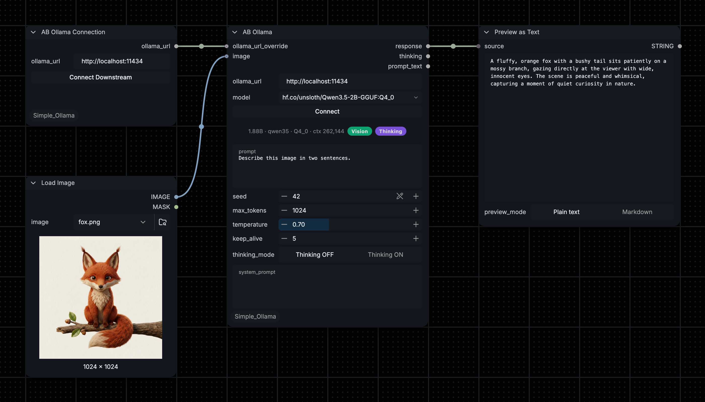

<div align="center">

# AB Simple Ollama: local LLMs and vision models in ComfyUI

**Send a prompt and an image to any Ollama server on your machine or network, get text back.**

<br />

[](https://github.com/a-und-b/ComfyUI_Simple_Ollama/stargazers)
&nbsp;
[](https://registry.comfy.org/nodes/comfyui-simple-ollama)
&nbsp;
[](https://registry.comfy.org/nodes/comfyui-simple-ollama)
&nbsp;
[](LICENSE)

<br />



---

Most Ollama integrations sit inside large node packs or were abandoned. AB Simple Ollama does one thing: it sends a prompt, with an optional image, to [Ollama](https://ollama.com) and returns the text. Connect fills the model list from your server, and an info row shows size, quantization, context window and what the model can do.

[Install](#install) · [Example workflow](#example-workflow) · [Features](#features) · [Usage](#usage) · [Contributing](#contributing)

</div>

---

## Why AB Simple Ollama

No API keys, no accounts, no extra pip packages: the pack uses the Python standard library plus PIL and numpy, which ComfyUI already ships. The node talks only to the Ollama URL you enter; see [Security](#security) before you expose ComfyUI to other people.

## Features

| You want | You use |
|----------|---------|
| The models on your server in the dropdown | **Connect** below the model field |
| Size, quantization, context window of a model | the info row, with chips for Vision and Thinking |
| A caption or answer about an image | an IMAGE (or an IMAGE batch) into `image` |
| The model's reasoning as its own output | `thinking_mode` on, output `thinking` |
| The model unloaded right after the run | `keep_alive` = `0` (`-1` keeps it loaded) |
| One server URL for many nodes | **AB Ollama Connection** → `ollama_url_override` |

## Install

**ComfyUI Manager:** search for **AB Simple Ollama**, install, restart ComfyUI.

**comfy-cli:**

```bash
comfy node install comfyui-simple-ollama
```

**Manually:**

```bash
cd ComfyUI/custom_nodes/
git clone https://github.com/a-und-b/ComfyUI_Simple_Ollama.git
```

No `pip` step. Restart ComfyUI. The nodes appear under **AB/LLM**; search for `AB Ollama` or `ollama`.

## Example workflow

[`ab-ollama-describe-image.json`](example_workflows/ab-ollama-describe-image.json): **AB Ollama Connection** (`http://localhost:11434`) and **Load Image** feed **AB Ollama**, which describes the image; **Preview as Text** shows the answer. Drag the file onto the canvas, or open it in ComfyUI under Workflow → Browse Templates, under the pack's name. Then:

1. Copy [`fox.png`](example_workflows/fox.png) into ComfyUI's `input/` folder, or pick your own image in **Load Image**.
2. Set your Ollama URL in **AB Ollama Connection** and click **Connect Downstream**.
3. Choose a model with the Vision chip and queue.

## Usage

1. Add **AB Ollama**.
2. Enter your Ollama server URL (e.g. `http://192.168.1.100:11434`).
3. Click **Connect**: the model dropdown fills from your server.
4. Select a model; the info row shows parameters, quantization and context window.
5. Write your prompt, adjust the settings, queue.

Notes:
- An IMAGE batch sends every frame to Ollama as its own entry in `messages[].images`.
- The Connect and model-info helper routes call the Ollama URL you enter: read [Security](#security) before you expose ComfyUI to untrusted users.

### Multiple Nodes / Shared URL

For several **AB Ollama** nodes in one workflow, add one **AB Ollama Connection** and connect its `ollama_url` output to each node's optional `ollama_url_override` input.

- All nodes then share one Ollama server URL.
- The node's own `ollama_url` field is the fallback when `ollama_url_override` is not connected.
- **Connect** and the info row use the shared URL when the override is wired.
- **Connect Downstream** on **AB Ollama Connection** fetches the models once, updates every connected **AB Ollama** node and writes the shared URL into each node's `ollama_url` field.
- A downstream node keeps its model when the server still has it; otherwise it switches to the first model and refreshes the info row.

### Inputs

| Input | Type | Required | Description |
|---|---|---|---|
| `ollama_url` | STRING | ✅ | Ollama server URL |
| `ollama_url_override` | STRING | ❌ | Optional shared URL, for example from **AB Ollama Connection** |
| `model` | COMBO | ✅ | Model selector (filled by Connect) |
| `prompt` | STRING | ✅ | Your prompt: context, instructions and question in one field |
| `seed` | INT | ✅ | Random seed for reproducible outputs |
| `max_tokens` | INT | ✅ | Max tokens to generate |
| `temperature` | FLOAT | ✅ | Sampling temperature (0 = deterministic) |
| `keep_alive` | FLOAT | ✅ | Minutes to keep the model loaded (`-1` = keep loaded, `0` = unload at once) |
| `thinking_mode` | BOOL | ✅ | Ask the model for its reasoning |
| `image` | IMAGE | ❌ | Optional vision input; a batch sends all frames |
| `system_prompt` | STRING | ❌ | System-level instruction |

### Outputs

| Output | Description |
|---|---|
| `response` | The model's text response |
| `thinking` | The model's reasoning (empty when thinking mode is off) |
| `prompt_text` | The prompt field, returned unchanged for debugging or logging |

### AB Ollama Connection outputs

| Output | Description |
|---|---|
| `ollama_url` | The normalized Ollama base URL for downstream **AB Ollama** nodes |

Up to 1.2.x the nodes were called *🦙 AB Simple Ollama* and *🦙 AB Simple Ollama Connection*, with Title Case field labels. Search still finds the old names, and saved workflows load unchanged.

## Requirements

- [Ollama](https://ollama.com) running somewhere reachable (localhost or LAN)
- ComfyUI (any recent version) with Python **3.10+**
- No pip install for this pack, no API keys, no accounts

## Security

This pack ships two server-side helper routes (`/simple_ollama/models` and
`/simple_ollama/model_info`) that fetch a **user-supplied URL** so the frontend
can list models. On a single-user, local ComfyUI that is what you want. **But**
because the ComfyUI *server* makes the request, anyone who can reach your
ComfyUI can make it fetch any `http(s)` URL: a classic
[SSRF](https://owasp.org/www-community/attacks/Server_Side_Request_Forgery)
risk. It matters when your ComfyUI is exposed to the internet or shared with
untrusted users (it could be pointed at cloud metadata endpoints or internal
services).

**Host allowlist.** To limit the backend to known Ollama hosts, set the
`SIMPLE_OLLAMA_ALLOWED_HOSTS` environment variable to a comma-separated list of
hostnames or IPs before starting ComfyUI:

```bash
export SIMPLE_OLLAMA_ALLOWED_HOSTS="localhost,127.0.0.1,192.168.1.100"
```

When set, the node (the helper routes **and** `run()`) refuses any URL whose
host is not on the list. When unset, any host is allowed (the default for local
installs). Matching is on hostname only (ports are not restricted) and ignores
case.

If you run ComfyUI behind a reverse proxy or on a shared machine, set the
allowlist and don't expose the raw ComfyUI port to the public internet.

## Contributing

Bug reports and pull requests are welcome. Open an [issue](https://github.com/a-und-b/ComfyUI_Simple_Ollama/issues) first for larger changes; [`CONTRIBUTING.md`](CONTRIBUTING.md) has the three steps.

## License

[MIT](LICENSE)

---

<div align="center">

Built by [Holger Will](https://github.com/a-und-b) at [anders & besser](https://andersundbesser.de)

<br />

[](https://github.com/a-und-b/ComfyUI_Simple_Ollama/stargazers)

</div>
